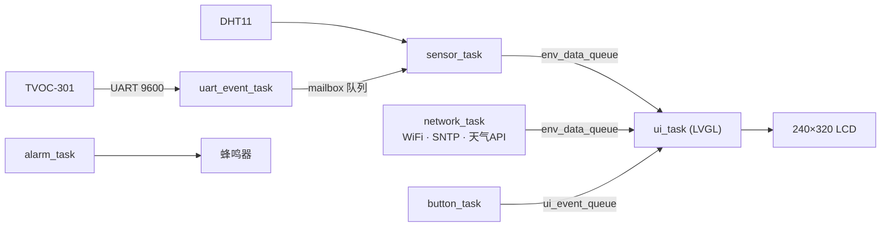

# EnvDesk 🌡️ — ESP32 多功能桌面环境监测仪


> 一台放在桌上的**环境监测小摆件**：时间日期、温湿度、空气质量（TVOC / 甲醛 / eCO2）、天气预报、闹钟，一块 2.4" 彩色 LCD 全部搞定。
> 基于 **ESP32 + ESP-IDF + FreeRTOS + LVGL**，代码结构清晰、模块化设计，适合学习 ESP-IDF 多任务开发，也适合直接做成自己的桌面玩具。

<!-- TODO: 替换为你的实物照片 -->
<p align="center">
  
</p>

---

## ✨ 功能特性

- 🕐 **网络对时时钟**：SNTP 自动对时（默认阿里云 NTP，UTC+8），断网后 RTC 继续走时
- 🌡 **温湿度监测**：DHT11（RMT 外设精确解码，不占 CPU 忙等）
- 🌫 **空气质量监测**：TVOC-301 UART 帧（带校验和状态机解析），三通道浓度 + 四级污染等级色条，超标自动告警
  - TVOC：0~5000 ug/m³ ｜ 甲醛（HCHO）：0~2000 ug/m³ ｜ eCO2：0~5000 ppm
- ☁️ **天气**：默认接入心知天气免费版（可切换和风天气），30 分钟自动刷新，断网保留最近数据
- ⏰ **闹钟**：3 组独立闹钟，支持周一~周日掩码，无源蜂鸣器渐强响铃，任意键停止
- 🖥 **UI**：LVGL 9 深色主题竖屏界面，中文字体子集渲染，卡片式布局
- 🔘 **实体按键交互**：MODE / UP / DOWN / OK（复用 BOOT 键）四键操作，免触屏
- 🔌 **WiFi 断线自愈**：指数退避自动重连，状态栏实时指示
- 💡 **可调背光**：LEDC PWM 调光，预留光敏电阻自动调光接口
- 🧩 **模块化架构**：驱动层 / 服务层 / UI 层单向依赖，换传感器只改一个文件

## 📦 硬件清单（BOM）

| # | 器件 | 规格 | 数量 | 参考价 | 备注 |
|:---:|---|---|:---:|:---:|---|
| 1 | ESP32 开发板 | ESP32-DevKitC / WROOM-32（4MB Flash） | 1 | ¥15~25 | 主控 |
| 2 | TFT LCD | 2.4" 240×320 SPI（ST7789 / ILI9341） | 1 | ¥15~25 | 非触摸 |
| 3 | TVOC-301 气体传感器模块 | UART 输出（广州传苣） | 1 | ¥40~60 | **5V 供电** |
| 4 | DHT11 温湿度模块 | 单总线，模块版带上拉 | 1 | ¥3~6 | — |
| 5 | 无源蜂鸣器 | 3V/5V 有源均可（无源音调更好） | 1 | ¥1~2 | — |
| 6 | NPN 三极管 | S8050 / 8050 | 1 | ¥0.1 | 驱动蜂鸣器 |
| 7 | 轻触按键 | 6×6mm | 3 | ¥0.3 | OK 键复用板载 BOOT |
| 8 | 电阻 | 10kΩ ×2（分压用）、4.7kΩ ×1（DHT11 上拉，模块版可省） | 若干 | ¥0.1 | 见下方电平说明 |
| 9 | 外壳 | 3D 打印 / 亚克力盒（可选） | 1 | — | 开源结构文件随附 |

> ⚠️ **电平提醒**：TVOC-301 必须 5V 供电；接入前先实测其 TXD 空闲电平，若为 5V 需经 `10kΩ/15kΩ` 分压后再接 ESP32 RX。完整接线见 [设计文档 §3](docs/Project_Design.md#3-硬件设计)。

## 🏗 软件架构（简述）



6 个 FreeRTOS 任务通过 **队列（mailbox / 快照）、事件组（网络状态位）、互斥锁（LVGL / 闹钟表）** 协作，任务划分、优先级、栈大小、IPC 设计与 UI 布局的完整说明请看 👉 **[docs/Project_Design.md](docs/Project_Design.md)**

## 🚀 快速开始

### 1. 环境准备

| 依赖 | 版本 |
|---|---|
| ESP-IDF | v5.1 及以上（推荐 v5.3） |
| LVGL | v9（由组件管理器自动拉取） |
| Python | 3.9+（IDF 环境自带） |

```bash
# 安装 ESP-IDF（已安装可跳过）
git clone -b v5.3 --recursive https://github.com/espressif/esp-idf.git
cd esp-idf && ./install.sh && source export.sh

# 克隆本仓库
git clone https://github.com/<your-github-id>/esp32-envmonitor.git
cd esp32-envmonitor
idf.py set-target esp32
idf.py add-dependency "lvgl/lvgl^9"
```

### 2. 配置 WiFi / 天气 API Key

首次配置通过 `menuconfig`（之后所有配置也可在设备 SettingPage 中修改并存入 NVS）：

```bash
idf.py menuconfig
```

```
EnvDesk Settings  --->
    (your_wifi_ssid)   WiFi SSID
    (your_wifi_pass)   WiFi Password
    (your_api_key)     Weather API Key          ← 心知天气控制台免费申请
    (guangzhou)        Weather Location ID
    (Asia/Shanghai)     Timezone
```

> 💡 免费天气 Key 申请：[心知天气](https://www.seniverse.com/) 控制台注册即得（`api.seniverse.com`）；也可在 `Kconfig` 中切换 Provider 为[和风天气](https://dev.qweather.com/)。

### 3. 编译烧录

```bash
idf.py build
idf.py -p /dev/ttyUSB0 flash monitor    # Windows: -p COM3
```

首次上电 → 自检 → 连接 WiFi → SNTP 对时（约 3~10 秒）→ 主界面出现时间与数据即成功。若 WiFi 配置错误，设备会进入配网模式（状态栏灰图标），此时可通过按键在 SettingPage 重新配置。

## 🔧 关键设计速览

- **TVOC-301 串口解析**：9 字节帧（帧头 `0x2C 0xE4` + 6 字节浓度 + 累加校验和），逐字节状态机解码，抗粘包/断帧，校验失败自动重新对齐帧头；解析结果进深度 1 的 mailbox 队列，UI 永远拿到最新值 → [设计文档 §6.1](docs/Project_Design.md#61-tvoc-301-串口解析核心)
- **FreeRTOS 任务划分**：6 任务 3 优先级梯队（解析 6 > 采集/按键 4 > UI 3 > 网络 2），队列快照 + 事件组状态广播，无裸全局变量 → [设计文档 §4](docs/Project_Design.md#4-freertos-任务划分与通信机制)
- **UI**：240×320 竖屏五区布局（状态栏 / 时钟 / 温湿度 / 空气质量 / 天气），LVGL 双缓冲 + 1ms tick + 中文 GB2312 子集字体 → [设计文档 §5](docs/Project_Design.md#5-ui-布局规划240320-竖屏)

## 🗺 Roadmap

- [ ] M0 工程骨架 + LCD 驱动 + LVGL 静态布局
- [ ] M1 双传感器数据上屏
- [ ] M2 WiFi + SNTP 对时
- [ ] M3 天气 API 接入
- [ ] M4 闹钟 + 按键交互
- [ ] M5 主题打磨与开源发布
- [ ] Future：I2C 扩展高精度传感器（BME280/SGP30）、光敏自动调光、OTA 升级、MQTT 上报 Home Assistant

## 🤝 贡献

欢迎提交 Issue 与 PR！提交前请阅读 [设计文档](docs/Project_Design.md) 了解架构约定（分层依赖 / IPC 规则 / 驱动抽象）。

## 📄 开源协议

本项目代码采用 [**MIT License**](LICENSE) 开源，可自由用于个人与商业用途，保留版权声明即可。

传感器说明书等第三方文档版权归各自厂商所有。

## 🙏 致谢

- [Espressif](https://www.espressif.com/) — ESP-IDF 框架
- [LVGL](https://lvgl.io/) — 嵌入式图形库
- TVOC-301 通信协议整理自官方《使用说明书(UART) V00.001》
- 灵感来源：桌面时钟 & 环境监测类开源项目社区

---

<p align="center">如果这个项目对你有帮助，欢迎点一个 ⭐ Star</p>
